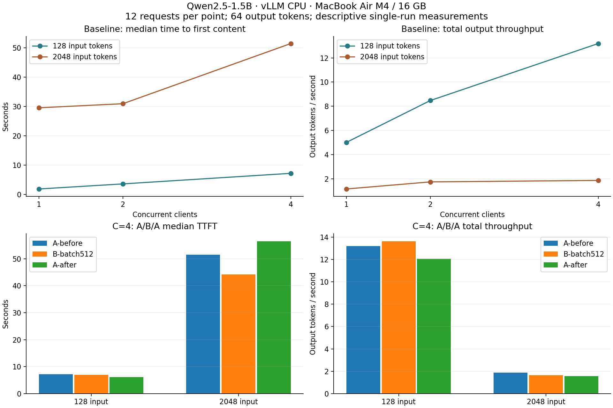

# Нагрузочные измерения: фактические результаты

120 измеряемых запросов, по 12 в точке; ещё 30 прогревочных запросов исключены из производительности. Пробные 4 + 1 прогрев в итоговые таблицы не включены.

Протокол: [05-protocol.md](05-protocol.md). Машиночитаемая таблица: [CSV](05-summary.csv).

## Исходная конфигурация: пакет 1024

| Вход | Клиенты | TTFT med / p95, с | Latency med / p95, с | Выход, ток/с | Запросы/с | Ошибки |
|---:|---:|---:|---:|---:|---:|---:|
| 128 | 1 | 1.811 / 1.989 | 12.902 / 13.176 | 5.008 | 0.0783 | 0 |
| 128 | 2 | 3.547 / 4.154 | 14.994 / 15.669 | 8.473 | 0.1324 | 0 |
| 128 | 4 | 7.154 / 7.310 | 19.167 / 19.939 | 13.188 | 0.2061 | 0 |
| 2048 | 1 | 29.524 / 67.652 | 42.036 / 122.712 | 1.158 | 0.0181 | 0 |
| 2048 | 2 | 30.916 / 58.430 | 73.135 / 101.129 | 1.745 | 0.0273 | 0 |
| 2048 | 4 | 51.462 / 116.422 | 136.893 / 202.091 | 1.866 | 0.0291 | 0 |

## Сравнение настройки при четырёх клиентах

| Вход | Серия | Пакет | TTFT med / p95, с | Latency med / p95, с | Выход, ток/с |
|---:|---|---:|---:|---:|---:|
| 128 | A-before | 1024 | 7.154 / 7.310 | 19.167 / 19.939 | 13.188 |
| 128 | B-batch512 | 512 | 6.945 / 7.143 | 18.590 / 19.242 | 13.634 |
| 128 | A-after | 1024 | 6.079 / 8.611 | 20.774 / 22.957 | 12.070 |
| 2048 | A-before | 1024 | 51.462 / 116.422 | 136.893 / 202.091 | 1.866 |
| 2048 | B-batch512 | 512 | 44.148 / 150.140 | 150.748 / 256.019 | 1.641 |
| 2048 | A-after | 1024 | 56.489 / 144.290 | 161.971 / 255.054 | 1.569 |

## Память и устойчивость

| Серия | Вход | Клиенты | Max sampled current, ГиБ | Max sampled working set, ГиБ | OOM kill | Preemption | Prefix hit tokens |
|---|---:|---:|---:|---:|---:|---:|---:|
| A-before | 128 | 1 | 6.750 | 5.777 | 0 | 0.0 | 0.0 |
| A-before | 128 | 2 | 6.766 | 5.792 | 0 | 0.0 | 0.0 |
| A-before | 128 | 4 | 6.778 | 5.805 | 0 | 0.0 | 0.0 |
| A-before | 2048 | 1 | 6.836 | 5.863 | 0 | 0.0 | 0.0 |
| A-before | 2048 | 2 | 6.836 | 5.862 | 0 | 0.0 | 0.0 |
| A-before | 2048 | 4 | 6.838 | 5.865 | 0 | 0.0 | 0.0 |
| B-batch512 | 128 | 4 | 7.032 | 6.214 | 0 | 0.0 | 0.0 |
| B-batch512 | 2048 | 4 | 7.070 | 6.252 | 0 | 0.0 | 0.0 |
| A-after | 128 | 4 | 6.882 | 6.069 | 0 | 0.0 | 0.0 |
| A-after | 2048 | 4 | 6.946 | 6.134 | 0 | 0.0 | 0.0 |

Current включает файловый кэш; working set = current − inactive_file. Пик выборки не гарантирует обнаружение кратковременного пика. memory.peak с начала жизни Pod и все cgroup-счётчики сохранены в сырых JSON.

## Изменения относительно первого A

- Вход 128: B относительно A-before — TTFT -2.9%, throughput +3.4%. A-after относительно A-before — TTFT -15.0%, throughput -8.5%.
- Вход 2048: B относительно A-before — TTFT -14.2%, throughput -12.1%. A-after относительно A-before — TTFT +9.8%, throughput -15.9%.

При N=12 nearest-rank p95 равен максимуму. Один проход A/B/A не даёт статистически надёжного выбора оптимума; разброс повторного A обязательно учитывается при интерпретации.

## Проверяемость

- [A-before: summary.json](05-benchmark/A-before/summary.json), время 2026-11-04T12:31:30.947098+00:00 — 2026-11-04T13:06:32.647121+00:00; рестарты 0 → 0.
- [B-batch512: summary.json](05-benchmark/B-batch512/summary.json), время 2026-11-04T13:08:37.699398+00:00 — 2026-11-04T13:20:12.290686+00:00; рестарты 0 → 0.
- [A-after: summary.json](05-benchmark/A-after/summary.json), время 2026-11-04T13:21:32.358397+00:00 — 2026-11-04T13:33:48.805872+00:00; рестарты 0 → 0.

Сводка проверяет одинаковые workload SHA256, модель, imageID, ресурсы и все настройки, кроме max_num_batched_tokens. Тексты ответов и токен авторизации не сохраняются.

